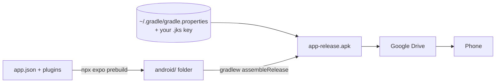

# Building a signed release APK (Windows, no EAS)

This builds `Tora-<version>.apk` on your Windows PC, signed with **your own upload key**, ready to put on Google Drive and install on your phone. Run every command in **PowerShell** (not Command Prompt).

Sources: Expo's [Create a release build locally](https://docs.expo.dev/guides/local-app-production/) and Android's [Sign your app](https://developer.android.com/studio/publish/app-signing).



How the pieces fit:
- `android/` is **generated** from `app.json` by `npx expo prebuild` and is never committed or edited by hand.
- Signing is set up by `plugins/with-release-signing.js`, which reads your key's details from `~/.gradle/gradle.properties` on your PC. That file and the key itself stay **outside this repo**.
- A release build without those details **stops with an error**, rather than quietly signing with the debug key.

---

## One-time setup

### 1. Point the tools at Android Studio's Java and SDK

Android Studio ships a Java runtime (JBR) and the Android SDK. Tell Gradle where they are, for your user account:

```powershell
[Environment]::SetEnvironmentVariable("JAVA_HOME", "C:\Program Files\Android\Android Studio\jbr", "User")
```

```powershell
[Environment]::SetEnvironmentVariable("ANDROID_HOME", "$env:LOCALAPPDATA\Android\Sdk", "User")
```

**Close PowerShell and open a new window**, then check both:

```powershell
& "$env:JAVA_HOME\bin\java.exe" -version
```

```powershell
Test-Path "$env:ANDROID_HOME\platform-tools"
```

The first prints a Java 17 or 21 version, and the second prints `True`. If Android Studio lives elsewhere, find the paths in Android Studio:
- **Java:** Settings → Build, Execution, Deployment → Build Tools → Gradle → Gradle JDK.
- **SDK:** Settings → Languages & Frameworks → Android SDK → "Android SDK Location".

### 2. Create your upload key (once, keep it forever)

The key goes in a folder **outside** the project:

```powershell
New-Item -ItemType Directory -Force "$HOME\tora-keys"
```

```powershell
& "$env:JAVA_HOME\bin\keytool.exe" -genkeypair -v -storetype PKCS12 -keystore "$HOME\tora-keys\tora-upload.jks" -alias tora -keyalg RSA -keysize 2048 -validity 10000
```

`keytool` asks for a password (twice), then your name and organisation. Any answers are fine; "Unknown" works.

**Back up `tora-upload.jks` and its password** (for example, a password manager plus a private Drive folder). Android only installs an update over the existing app when it's signed with the same key. Without the key you'd have to uninstall Tora and install it fresh. Your data is safe in Supabase, so you'd only need to log in again.

### 3. Tell Gradle about the key

This writes the key's details to `C:\Users\<you>\.gradle\gradle.properties`, your personal Gradle settings (outside the repo). Replace `YOUR-PASSWORD` with the password from step 2, used for both lines:

```powershell
New-Item -ItemType Directory -Force "$HOME\.gradle"
```

```powershell
$keyPath = "$HOME\tora-keys\tora-upload.jks" -replace '\\', '/'
Add-Content "$HOME\.gradle\gradle.properties" @"

TORA_UPLOAD_STORE_FILE=$keyPath
TORA_UPLOAD_KEY_ALIAS=tora
TORA_UPLOAD_STORE_PASSWORD=YOUR-PASSWORD
TORA_UPLOAD_KEY_PASSWORD=YOUR-PASSWORD
"@
```

Check the result:

```powershell
Get-Content "$HOME\.gradle\gradle.properties"
```

### 4. Enable long paths (avoids a common Windows build error)

React Native compiles C++ code with deep folder paths. Allow long paths in Git (this helps Git check out files; it does not fix the native build itself):

```powershell
git config --global core.longpaths true
```

Then allow them in Windows itself. This one needs **PowerShell opened as Administrator**:

```powershell
New-ItemProperty -Path "HKLM:\SYSTEM\CurrentControlSet\Control\FileSystem" -Name "LongPathsEnabled" -Value 1 -PropertyType DWORD -Force
```

**Restart Windows** after changing this setting.

### 5. Install CMake with a long-path-capable Ninja

Enabling long paths alone is not enough. Android SDK CMake 3.22.1 bundles Ninja 1.10.2, which cannot handle these paths. Even a short project folder such as `C:\tora` can fail with `ninja: error: mkdir(...): No such file or directory`.

1. In Android Studio, open **Settings → Languages & Frameworks → Android SDK → SDK Tools**.
2. Enable **Show Package Details**, expand **CMake**, select **3.31.6**, and click **Apply**. This package includes Ninja 1.12.1.
3. Open your personal Gradle settings:

```powershell
notepad "$HOME\.gradle\gradle.properties"
```

Keep your existing signing settings. Add this line (or update it if already present), then save:

```properties
android.cmakeVersion=3.31.6
```

Expo SDK 58 reads this setting from your Gradle user home; it survives `prebuild --clean`. Confirm the installed Ninja version:

```powershell
& "$env:ANDROID_HOME\cmake\3.31.6\bin\ninja.exe" --version
```

It should print `1.12.1`. See Expo's [Windows long-path troubleshooting](https://docs.expo.dev/troubleshooting/windows-long-paths/).

If a build has already failed, clear its generated native build files before retrying. From your project's `android` folder (for example `C:\tora\android`):

```powershell
.\gradlew.bat --stop
foreach ($buildCache in @("app\.cxx", "app\build")) {
    if (Test-Path $buildCache) {
        Remove-Item -Recurse -Force $buildCache
    }
}
.\gradlew.bat assembleRelease -PreactNativeArchitectures=arm64-v8a
```

These two folders contain generated build files only. When the build succeeds, continue at **Every release → step 6**. If it fails again, retain the complete error and check which CMake/Ninja path it names; it should use `cmake\3.31.6`, not `cmake\3.22.1`.

---

## Every release

### 1. Get the code and dependencies

```powershell
cd C:\Users\fathur\projects\tora-mobile
```

```powershell
git checkout master
```

```powershell
git pull
```

```powershell
npm ci
```

### 2. Check the app's settings file

The Supabase address, the publishable key and the web address are baked into the APK when it's built, from `.env.local`. Make sure it exists and has real values:

```powershell
Get-Content .env.local
```

You should see `EXPO_PUBLIC_SUPABASE_URL`, `EXPO_PUBLIC_SUPABASE_PUBLISHABLE_KEY` and `EXPO_PUBLIC_WEB_URL` with real values (same as the web app's). Never put the secret/service_role key here.

### 3. Set the version (only for an update)

For the first release, skip this: it's `1.0.0`, versionCode `1`. For each later release, edit `app.json`:
- Raise `"version"`, e.g. `"1.0.1"` (the name you see).
- Raise `"android"` → `"versionCode"` by 1, e.g. `2`. Android refuses to install an update whose versionCode isn't higher than the installed one.

### 4. Generate the `android/` folder

```powershell
npx expo prebuild --platform android --clean
```

`--clean` rebuilds `android/` from `app.json`, so it always matches the config (icon, splash, package name, signing).

### 5. Build the signed APK

```powershell
cd android
```

```powershell
.\gradlew.bat assembleRelease
```

The first build takes a while (often 10–20 minutes) while Gradle downloads its tools; later builds are faster. It ends with `BUILD SUCCESSFUL`.

Optional, for a smaller APK and a faster build: almost every current Android phone is 64-bit ARM, so you can build only for that:

```powershell
.\gradlew.bat assembleRelease -PreactNativeArchitectures=arm64-v8a
```

### 6. Copy the APK somewhere easy to find

```powershell
cd ..
```

```powershell
$version = (Get-Content app.json | ConvertFrom-Json).expo.version
Copy-Item android\app\build\outputs\apk\release\app-release.apk "$HOME\Desktop\Tora-$version.apk"
```

### 7. (Optional) Confirm it's signed with your key

```powershell
$apksigner = Get-ChildItem "$env:ANDROID_HOME\build-tools\*\apksigner.bat" | Sort-Object FullName | Select-Object -Last 1
& $apksigner.FullName verify --print-certs "$HOME\Desktop\Tora-$version.apk"
```

The certificate should show the name you typed in `keytool`, **not** "Android Debug".

### 8. Install on your phone

- **Google Drive:** upload `Tora-<version>.apk`, open it from the Drive app on the phone, and tap Install. The first time, Android asks to allow Drive to install unknown apps; allow it.
- **Or USB** (with USB debugging on):

```powershell
& "$env:ANDROID_HOME\platform-tools\adb.exe" install -r "$HOME\Desktop\Tora-$version.apk"
```

The installed app is called **Tora** (package `com.mustafafathur.tora`). It's separate from Expo Go, which you keep using for development.

---

## If something goes wrong

| Message | Fix |
|---|---|
| `Release signing isn't set up: add TORA_UPLOAD_STORE_FILE …` | One-time setup steps 2–3. Check `Get-Content "$HOME\.gradle\gradle.properties"`. |
| `SDK location not found` | `ANDROID_HOME` isn't set in this window: setup step 1, then open a new PowerShell. |
| `JAVA_HOME is not set` / wrong Java version | Setup step 1 (use Android Studio's `jbr`). |
| `Keystore was tampered with, or password was incorrect` | The password in `gradle.properties` doesn't match the key. |
| `Filename longer than 260 characters` / `ninja: error: mkdir(...)` / CMake path errors | One-time setup steps 4–5: enable Windows long paths, use CMake 3.31.6 with newer Ninja, and clear the generated build caches. A shorter project path alone may not be enough. |
| `INSTALL_FAILED_UPDATE_INCOMPATIBLE` on the phone | The installed Tora was signed with a different key. Uninstall it, then install again. |
| Login fails only in the APK | `.env.local` was missing or wrong when you built. Fix it, then repeat steps 4–6. |

Never commit `android/`, `*.jks`, `*.keystore` or `gradle.properties`; `.gitignore` already blocks them.
